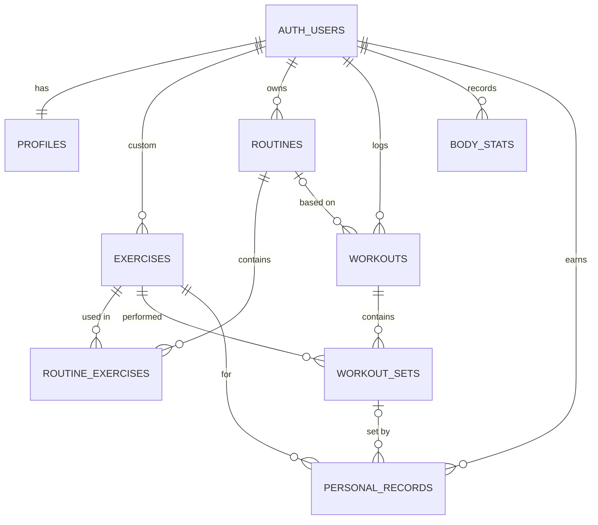

# GymBuddy database (Supabase)

Postgres 17 on Supabase. Every table has Row Level Security (RLS) enabled.
Project ref: `ndgnpkjvmspgdsrifxbe`.

## Schema



| Table | Purpose | Who can read | Who can write |
|---|---|---|---|
| `profiles` | Settings and onboarding answers (row id = user id). Auto-created on sign-up. | Owner | Owner |
| `exercises` | Library. `user_id` null = built-in. | Everyone, incl. signed-out (built-in); owner (custom) | Owner (custom only) |
| `routines` | Plans; `days[]` holds split day names. `user_id` null = starter template. | Signed-in (templates); owner | Owner |
| `routine_exercises` | Exercises per routine day with target sets/reps/rest. | Signed-in (templates); owner | Owner, only into own routines |
| `workouts` | Logged sessions. | Owner | Owner |
| `workout_sets` | Logged sets; weight in kg; `estimated_1rm_kg` generated (Epley, 1–12 reps). | Owner | Owner, only into own workouts |
| `body_stats` | Body weight, body fat, progress photo path. | Owner | Owner |
| `personal_records` | Best `max_weight` / `max_reps` / `max_e1rm` / `max_volume` per exercise. | Owner | Owner |

Storage: private bucket `progress-photos` (5 MB, images only). Object path `{user_id}/{uuid}.jpg`;
users can only read/write their own folder. Photos are displayed with signed URLs.

## Sync columns (offline-first)

Every synced table has `id` (UUID, generated on the device), `user_id`, `created_at`, `updated_at`,
`deleted_at` (soft delete) and `synced_at`.

The `sync_row_guard` trigger:
- skips an UPDATE whose `updated_at` is older than the stored row (last write wins),
- blocks changing `user_id`,
- stamps `synced_at = now()` so the app can pull changes with `synced_at > lastPulledAt`.

## Reference data

`20261112110036_seed_exercises_and_starter_routines.sql` adds 40 exercises across 10 muscle groups and
3 starter routines (Push/Pull/Legs, Full Body, Upper/Lower). Ids are fixed UUIDv5 values from
`scripts/generate_seed.py`, so they are identical in every environment.

## Verified

- Security advisor: no findings.
- RLS test (two users + signed-out visitor, rolled back): users cannot read, update, delete or insert into
  each other's data, cannot spoof `user_id`, cannot edit built-in exercises; signed-out visitors see only
  the 40 built-in exercises.

## Working with the CLI (on your machine)

```bash
npm install -D supabase          # or: brew install supabase/tap/supabase
npx supabase login               # opens the browser, creates an access token
npx supabase link --project-ref ndgnpkjvmspgdsrifxbe   # asks for the database password
npx supabase migration list      # local and remote should match
```

New schema change:

```bash
npx supabase migration new add_something   # creates supabase/migrations/<timestamp>_add_something.sql
# edit the file, then
npx supabase db push
```
